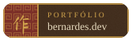
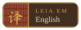
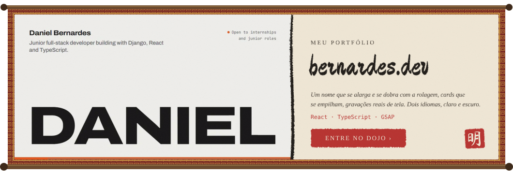
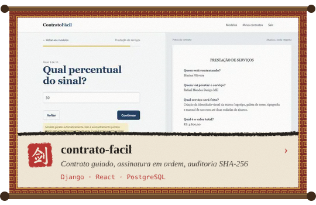
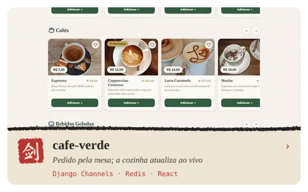
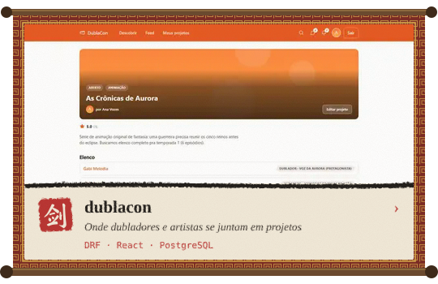
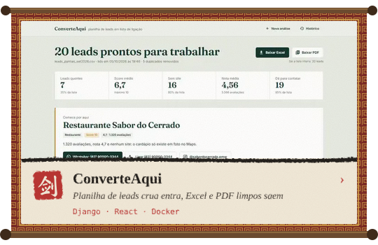
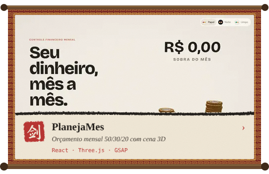
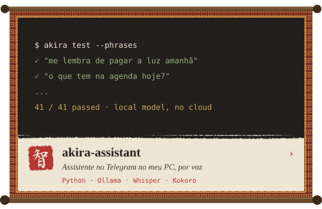
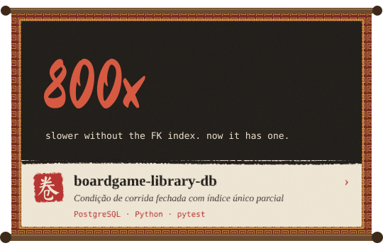

Ciência da Computação no Ceulp/ULBRA, estagiário de TI na <b>EGEFAZ</b>. Começo numa bagunça real e termino com a correção medida e testada.

  
  
  
  

  
  
  
  
  
  
  

Menores: <a href="https://github.com/Yourdevdaniel/Projeto-Arvore">Projeto-Arvore</a> · <a href="https://github.com/Yourdevdaniel/transit-router">transit-router</a> · tudo em <a href="https://bernardes.dev">bernardes.dev</a>

<i>“Não faça nada que não tenha utilidade.” (Miyamoto Musashi)</i>

