
Computer Science at Ceulp/ULBRA, IT intern at <b>EGEFAZ</b>. I start from a real mess and end with the fix measured and tested.

  
  
  
  

<a href="https://bernardes.dev">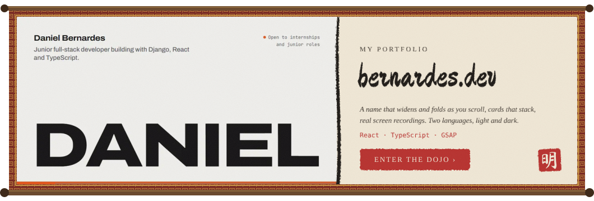</a>

  <a href="https://github.com/Yourdevdaniel/contrato-facil">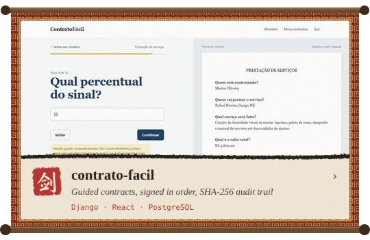</a>
  <a href="https://github.com/Yourdevdaniel/cafe-verde">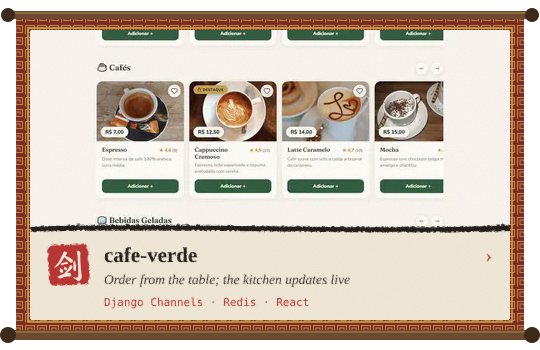</a>
  <a href="https://github.com/Yourdevdaniel/dublacon">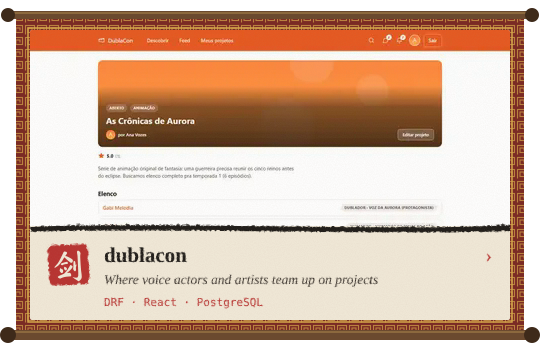</a>
  <a href="https://github.com/Yourdevdaniel/ConverteAqui">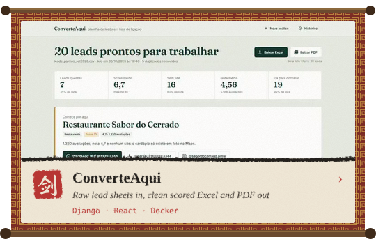</a>
  <a href="https://github.com/Yourdevdaniel/PlanejaMes">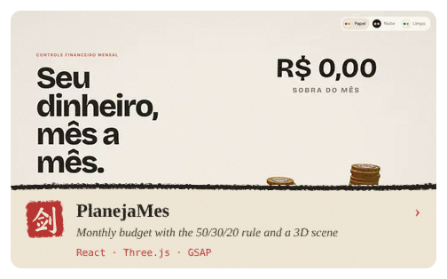</a>
  <a href="https://github.com/Yourdevdaniel/akira-assistant">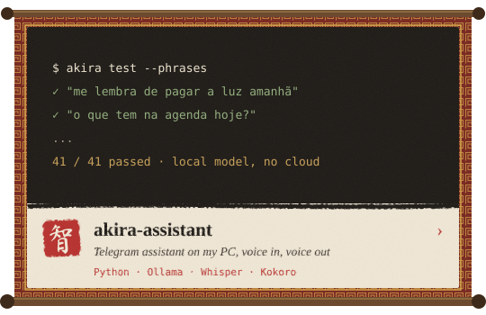</a>
  <a href="https://github.com/Yourdevdaniel/boardgame-library-db">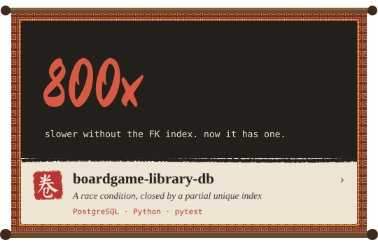</a>

Smaller ones: <a href="https://github.com/Yourdevdaniel/Projeto-Arvore">Projeto-Arvore</a> · <a href="https://github.com/Yourdevdaniel/transit-router">transit-router</a> · everything at <a href="https://bernardes.dev">bernardes.dev</a>


<i>“Do nothing that is of no use.” (Miyamoto Musashi)</i>

